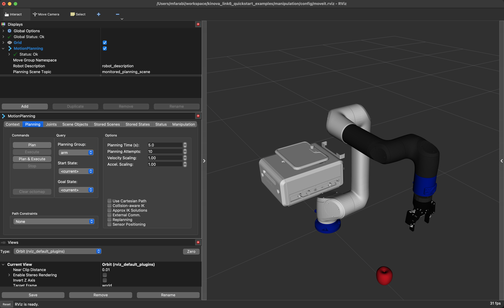
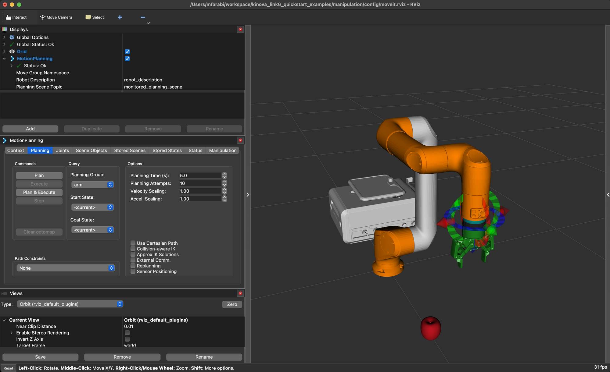
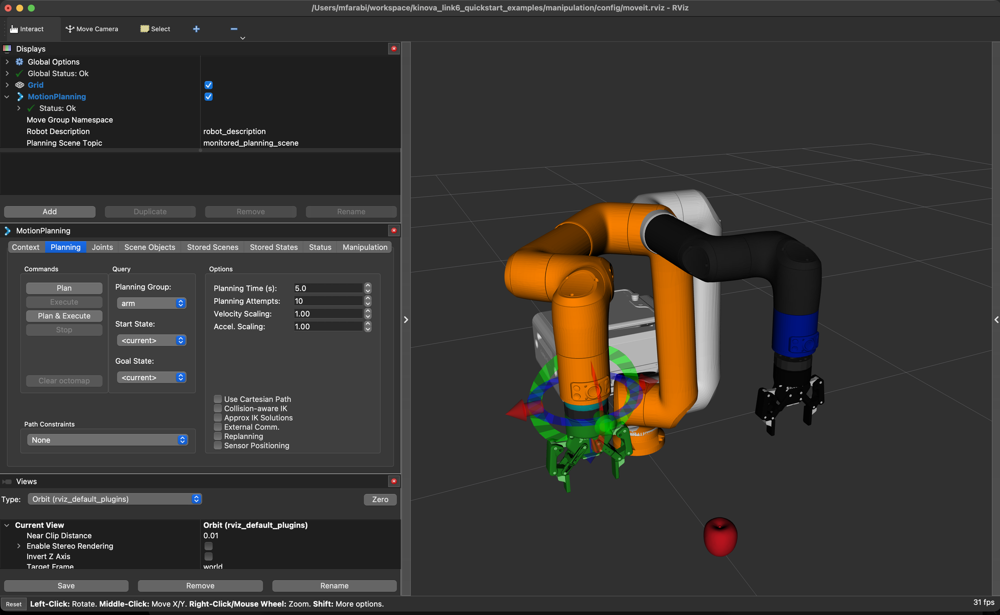
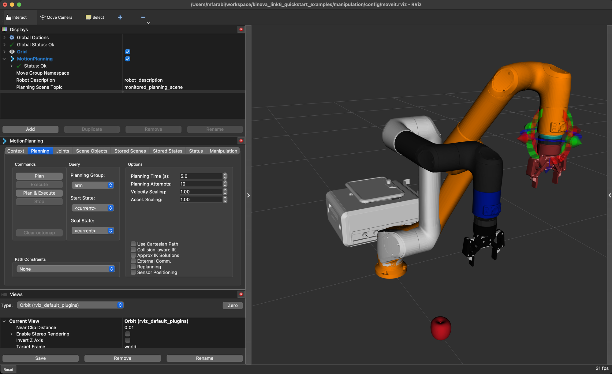
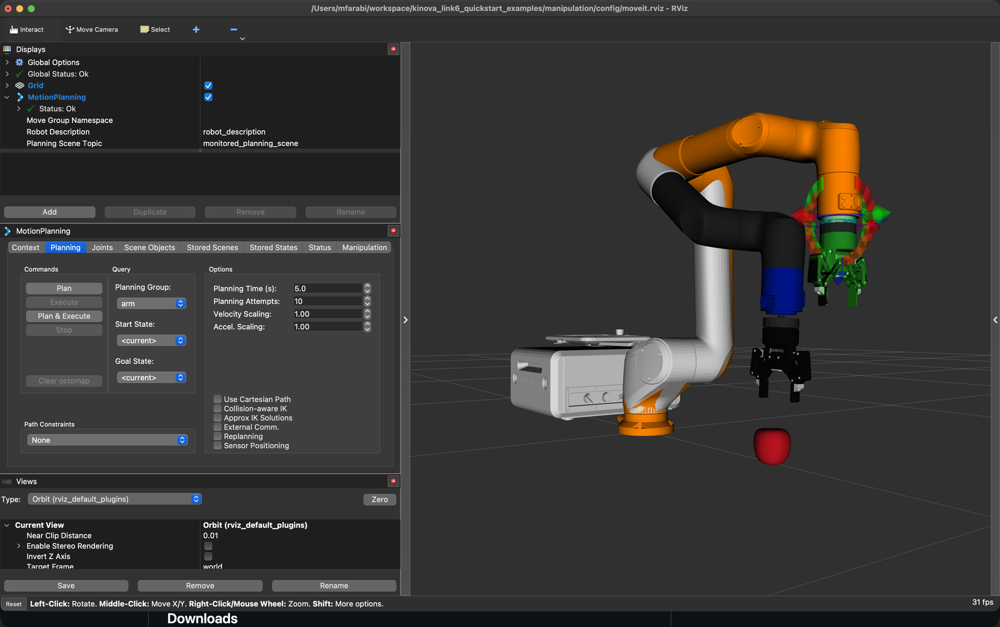
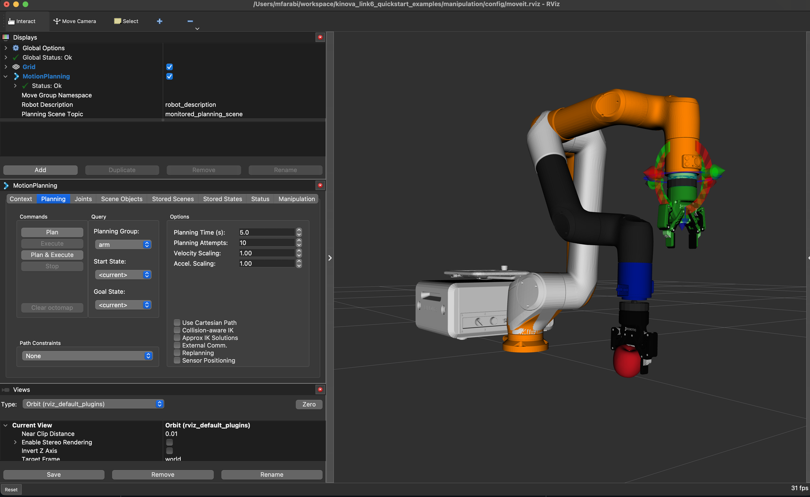
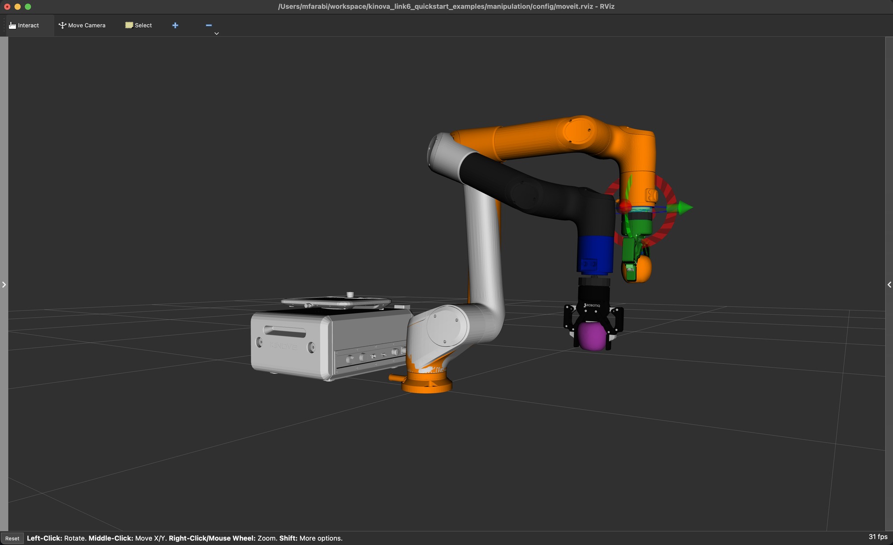
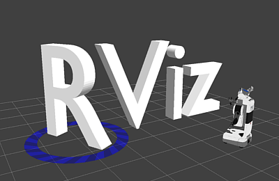
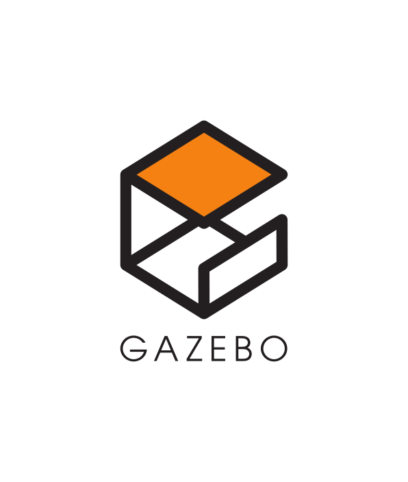
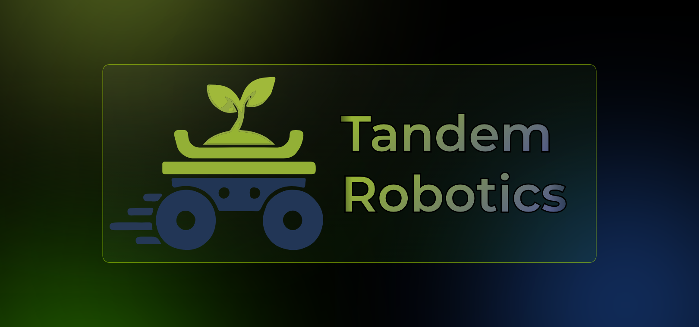

# kinova_link6_quickstart_examples

[](https://github.com/tandemrobotics/kinova_link6_quickstart_examples/actions/workflows/ci.yaml)
[](https://pixi.sh)
[](https://docs.ros.org/en/jazzy/)
[](https://isocpp.org)
[](https://www.python.org)
[](https://robostack.github.io)
[](LICENSE)

Scaffolding setup for [Kinova Robotics](https://www.kinovarobotics.com)' [Link 6](https://www.kinovarobotics.com/product/link-6) robot arm, useful for fast-tracking bringup and software development.

Being evaluated for production deployments by [Tandem Robotics](https://tandemrobotics.dev) for harsh agricultural conditions.

TODO: add banner image

## Getting Started

Install [Pixi](https://pixi.prefix.dev/latest/)

```
git clone https://github.com/tandemrobotics/kinova_link6_quickstart_examples
cd kinova_link6_quickstart_examples
```

Fetch the pinned vendor sources, and apply the recorded patches ([patches.yml](patches.yml)):

```
pixi r west update
pixi r west pa
```

`west pa` / `west pc` are the apply/clean aliases defined in [.west/config](.west/config).

Build the vendor packages:

```
pixi r build
```

Launch the simulation (RViz+MuJoCo ):

```
pixi r sim
```

<table>
  <tr>
    <td></td>
    <td></td>
    <td></td>
  </tr>
  <tr>
    <td></td>
    <td></td>
    <td></td>
  </tr>
</table>

With the simulation running, pick up the apple with the [MoveIt Task Constructor](https://moveit.github.io/moveit_task_constructor/):

```
pixi r pick
```

<table>
  <tr>
    <td></td>
    <td></td>
    <td></td>
  </tr>
</table>

<p>
  <a href="https://docs.ros.org/en/jazzy/Tutorials/Intermediate/RViz/RViz-Main.html"></a>&nbsp;&nbsp;
  <a href="https://gazebosim.org/home"></a>&nbsp;&nbsp;
  <a href="https://mujoco.org"></a>
</p>

## Downloads

Vendor binaries come from [Kinova's artifactory](https://artifactory.kinovaapps.com/ui/native/generic-public/). The `kortex_api` wheel version must match the controller firmware version.

| Artifact | Version | Link |
|---|---|---|
| Link 6 firmware (`.swu`) | 3.4.0 | [kortex/link6/3.4.0](https://artifactory.kinovaapps.com/artifactory/generic-public/kortex/link6/3.4.0/) |
| `kortex_api` Python wheel | 3.4.0.15 | [kortex/API/3.4.0](https://artifactory.kinovaapps.com/artifactory/generic-public/kortex/API/3.4.0/kortex_api-3.4.0.15-py3-none-any.whl) |
| Vision Plugin (`.kp`, install via Kontrol) | 1.2.0 | [plugins/vision_plugin/release/1.2.0](https://artifactory.kinovaapps.com/artifactory/generic-public/plugins/vision_plugin/release/1.2.0/vision_plugin_1.2.0.kp) |
| User guides (arm, plugins, vision) | — | [Documentation/Link 6](https://artifactory.kinovaapps.com/artifactory/generic-public/Documentation/Link%206/) |

The Vision Module is license-locked per camera: registering it in Kontrol requires the unlock code for your camera's MAC address (from the packaging, or support@kinova.ca).

Made with ❤️ by [Tandem Robotics](https://tandemrobotics.dev).

